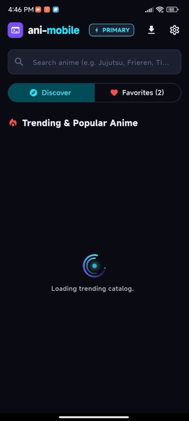

# ani-mobile 🎬

[](https://github.com/NonLaHu/ani_mobile/releases)
[](LICENSE)
[](https://flutter.dev)
[](https://dart.dev)

A cross-platform Flutter anime streaming and downloading application.

`ani-mobile` allows anime enthusiasts to search for titles, select episodes, switch between subbed and dubbed audio, and stream high-quality video directly inside the app with custom on-screen player controls, automated fallback recovery, offline downloads, and watch history tracking.

---

## 📱 Demo

<p align="center">
  <a href="https://github.com/NonLaHu/ani_mobile/raw/main/assets/demo.mp4">
    
  </a>
  <br />
  <sub>▶️ <b>Click preview above to watch or download the full demo video (<a href="https://github.com/NonLaHu/ani_mobile/raw/main/assets/demo.mp4">assets/demo.mp4</a>)</b></sub>
</p>

---

## 🚀 Installation & Quick Start

### 1. Download Pre-Compiled Android APK (Easiest)

Grab the latest release directly from [GitHub Releases](https://github.com/NonLaHu/ani_mobile/releases/latest):

| Package / Architecture | Target Devices | Description |
| :--- | :--- | :--- |
| **`ani_mobile-v1.0.1.apk`** | **All Devices (Universal)** | Universal APK containing all native ABIs. Compatible with any Android 5.0+ device. |
| **`ani_mobile-v1.0.1-arm64-v8a.apk`** | 64-bit ARM | Optimized for modern smartphones and tablets (smaller file size). |
| **`ani_mobile-v1.0.1-armeabi-v7a.apk`** | 32-bit ARM | For legacy or budget 32-bit Android devices. |
| **`ani_mobile-v1.0.1-x86_64.apk`** | 64-bit x86 | Best for Android emulators, ChromeOS, and x86 tablets. |

> [!TIP]
> **Automatic In-App Updates**: `ani-mobile` checks GitHub Releases on startup. When a new version is available, you can view release notes and download/install the update directly within the app in one tap.

---

### 2. Build & Run from Source

#### Prerequisites
- [Flutter SDK](https://docs.flutter.dev/get-started/install) (v3.3.0 or later)
- Android SDK (for Android builds) or Desktop toolchains (for Linux/Windows)

#### Step-by-Step

1. **Clone the repository**:
   ```bash
   git clone https://github.com/NonLaHu/ani_mobile.git
   cd ani_mobile
   ```

2. **Install Flutter dependencies**:
   ```bash
   flutter pub get
   ```

3. **Run unit tests**:
   ```bash
   flutter test
   ```

4. **Launch the application**:
   ```bash
   # On Connected Android Device or Emulator:
   flutter run -d android

   # On Linux Desktop:
   flutter run -d linux

   # On Windows:
   flutter run -d windows
   ```

5. **Build Android Release APK**:
   ```bash
   # Universal release APK:
   flutter build apk --release

   # Or generate split per-ABI APKs (smaller file sizes):
   flutter build apk --split-per-abi --release
   ```
   Generated binaries are output to `build/app/outputs/flutter-apk/`.

---

### 🔧 Platform-Specific Setup for `media_kit`

`media_kit` uses native `mpv` under the hood. Depending on your operating system, ensure the required native dependencies are present:

#### 🐧 Linux
On Ubuntu / Debian:
```bash
sudo apt update
sudo apt install -y libmpv-dev mpv libgtk-3-dev
```
On Arch Linux:
```bash
sudo pacman -S mpv gtk3
```

#### 🤖 Android
Configured out of the box in `android/`:
- `minSdkVersion 21` in `android/app/build.gradle.kts`.
- Permissions (`INTERNET`, `ACCESS_NETWORK_STATE`, `REQUEST_INSTALL_PACKAGES`) and `hardwareAccelerated="true"` in `AndroidManifest.xml`.

#### 🍎 iOS / macOS
Ensure arbitrary loads are permitted in `ios/Runner/Info.plist` to stream from diverse anime CDNs:
```xml
<key>NSAppTransportSecurity</key>
<dict>
    <key>NSAllowsArbitraryLoads</key>
    <true/>
</dict>
```

#### 🪟 Windows
Windows builds automatically link with `media_kit_libs_video` pre-compiled DLLs. Ensure the Visual Studio C++ desktop development workload is installed.

---

## 🌟 Key Features

- **Fast & Clean UX**: Minimalist, fast, and media-focused workflow in a modern GUI.
- **Hardware-Accelerated MPV Playback**: Powered by `media_kit` (using `libmpv` under the hood), supporting high-performance HLS multi-bitrate streaming (`.m3u8`) and direct MP4 playback.
- **Custom HTTP Header Injection**: Native injection of required `Referer`, `User-Agent`, and `Origin` headers into both `Dio` HTTP network requests and `media_kit` `Media` streaming instances to prevent CDN 403 Forbidden errors.
- **Automatic Stream Fallback & Error Recovery**: If a video source link fails, times out, or is blocked, the player automatically catches the error and falls back to the next available quality or backup server without interrupting playback.
- **Quick Skip Intro (+85s)**: One-tap button to instantly leap past anime opening themes (defaulting to the standard 85-second anime opening window or custom scraped timestamps).
- **Sub / Dub Catalog Switching**: Quick toggle between Japanese Subtitled and English Dubbed episode releases.
- **Watch History & Progress Resume**: Persists playback position and completed episodes locally using `shared_preferences` with a "Continue Watching" carousel on the home screen.
- **Modern Dark-Mode Material 3 UI**: Clean OLED-friendly obsidian & slate theme with electric violet and cyan accents tailored for late-night viewing.
- **Multi-Provider Architecture**: Modular scraper architecture supporting primary streaming providers, fallback providers, and test providers.

---

## 🏗️ Project Architecture

The `lib/` directory is organized using a clean, modular structure decoupling scraping logic, state management, and UI:

```
lib/
├── main.dart                          # App entrypoint & MediaKit initialization
├── models/
│   ├── anime.dart                     # Anime title, synopsis, genres, and metadata
│   ├── episode.dart                   # Episode numbers, titles, dub/sub flags
│   ├── video_source.dart              # Stream URLs, qualities, HTTP headers, & bundles
│   └── watch_history.dart             # Resume timestamps & playback progress
├── services/
│   ├── download/                      # HLS & direct video download engine
│   └── scraper/
│       ├── anime_scraper_service.dart # Abstract scraper interface
│       ├── base_scraper.dart          # Dio networking, regex extraction, & HTML helpers
│       ├── demo_scraper_service.dart  # Provider 3 test streams
│       ├── hianime_scraper_service.dart # Primary provider engine
│       ├── live_scraper_service.dart  # Secondary provider engine
│       └── scraper_factory.dart       # Factory for toggling scraper engines
├── providers/
│   ├── scraper_provider.dart          # Scraper engine selector provider
│   ├── search_provider.dart           # Query state, search results, & search history
│   ├── anime_details_provider.dart    # Anime details, sub/dub toggle, & episode lists
│   ├── player_provider.dart           # Active episode, stream sources, & fallback logic
│   ├── download_provider.dart         # Download state, tracking, & storage persistence
│   └── watch_history_provider.dart    # SharedPreferences watch history persistence
├── screens/
│   ├── home_screen.dart               # Search bar, engine switcher, continue watching, grid
│   ├── details_screen.dart            # Hero banner, synopsis, sub/dub toggle, episode list/grid
│   ├── player_screen.dart             # Fullscreen media_kit video player with custom controls
│   ├── downloads_screen.dart          # Offline downloaded & downloading media manager
│   └── settings_screen.dart           # Theme, player rendering, subtitle & storage settings
├── widgets/
│   ├── anime_card.dart                # Responsive anime poster card with badges
│   ├── history_card.dart              # Continue watching card with progress indicator
│   ├── quality_selector_sheet.dart    # Modal sheet for switching stream quality & servers
│   └── custom_video_controls.dart     # Seeker, play/pause, +/-10s, next/prev, skip intro
└── theme/
    └── app_theme.dart                 # Dark & light Material 3 theme palette & styling
```

---

## 📦 Tech Stack & Packages

| Package | Version | Purpose |
| :--- | :--- | :--- |
| **`dio`** | `^5.7.0` | High-performance HTTP client with interceptors, timeouts, and custom headers. |
| **`html`** | `^0.15.4` | DOM querying and CSS-selector parsing for scraping anime portals. |
| **`media_kit`** | `^1.1.11` | Cross-platform video player core utilizing `mpv` under the hood. |
| **`media_kit_video`**| `^1.2.5` | Flutter widgets and texture rendering for `media_kit`. |
| **`media_kit_libs_video`** | `^1.0.5` | Platform-specific pre-compiled native `libmpv` binaries. |
| **`flutter_riverpod`** | `^2.6.1` | Reactive state management decoupling business logic from UI. |
| **`shared_preferences`**| `^2.3.2` | Persistent key-value storage for watch history and user preferences. |

---

## 🌐 Custom HTTP Header Injection Details

Many video streaming CDNs reject requests that lack appropriate `Referer` or `User-Agent` headers. `ani-mobile` natively injects custom headers into both Dio and `media_kit`:

### 1. In Scraper Network Requests (`Dio`):
```dart
final headers = buildHeaders(
  referer: 'https://megacloud.tv/embed-2/e-1/?z=',
  userAgent: BaseScraper.defaultUserAgent,
  extra: {'Origin': 'https://megacloud.tv'},
);
```

### 2. In Video Streaming (`media_kit`):
```dart
// Native libmpv header injection
final media = Media(
  source.url,
  httpHeaders: source.headers,
  start: startPosition > Duration.zero ? startPosition : null,
);

_player.open(media, play: true);
```

---

## 🔌 How to Plug in Custom Scraping Endpoints & Parsing Rules

To add a new anime provider (e.g. a custom API or web scraper):

1. **Implement `AnimeScraperService`**:
   Create a new class in `lib/services/scraper/my_custom_scraper.dart`:
   ```dart
   import 'package:ani_mobile/services/scraper/anime_scraper_service.dart';
   import 'package:ani_mobile/services/scraper/base_scraper.dart';
   import 'package:ani_mobile/models/anime.dart';
   import 'package:ani_mobile/models/episode.dart';
   import 'package:ani_mobile/models/video_source.dart';

   class MyCustomScraper extends BaseScraper implements AnimeScraperService {
     @override
     String get name => 'MyCustomAnime';

     static const String baseUrl = 'https://my-anime-provider.to';

     @override
     Future<List<Anime>> searchAnime(String query) async {
       // 1. Fetch HTML or JSON
       final doc = await fetchHtml('$baseUrl/search?q=$query');

       // 2. Extract anime elements with CSS selectors
       final results = <Anime>[];
       for (final el in doc.querySelectorAll('.anime-card')) {
         final title = el.querySelector('.title')?.text.trim() ?? '';
         final id = el.attributes['data-id'] ?? '';
         final cover = el.querySelector('img')?.attributes['src'] ?? '';
         results.add(Anime(id: id, title: title, coverImage: cover, synopsis: ''));
       }
       return results;
     }

     @override
     Future<List<Episode>> getEpisodes(String animeId, {bool dub = false}) async {
       // Return list of episodes
     }

     @override
     Future<StreamBundle> getStreamSources(String episodeId) async {
       // 1. Extract player iframe or direct m3u8
       // 2. Return StreamBundle with required HTTP Referer & User-Agent
     }
   }
   ```

2. **Register with `ScraperFactory`**:
   Add your scraper to `lib/services/scraper/scraper_factory.dart` and the engine selector popup on `HomeScreen`.

---

## 💡 Troubleshooting & Playback Tips

- **False-Positive "Not Aired Yet" / Stream Unavailable**: If an episode appears unavailable even though it has aired, the third-party embed host may be geo-restricted or blocked by your ISP/network. Enabling a VPN or switching server regions resolves most host blockades.
- **Hardware Acceleration**: On Linux systems or devices with specific GPU driver limitations, software rendering can be toggled in `Settings > Video Player Rendering`.

---

## ⚖️ Disclaimer

The developers of `ani-mobile` do not host, store, or distribute any media files; users assume full legal responsibility for how they use this tool and for complying with applicable local laws.

---

## 📜 License

Licensed under the [MIT License](LICENSE).
